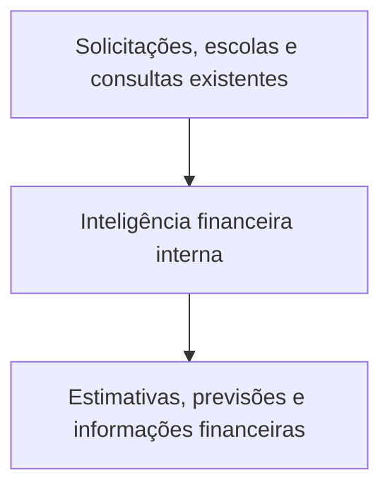
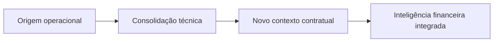

**GOP CLIMA / 3ª CRE**

CONCEPÇÃO  
FUNCIONAL DO  
PRODUTO

Evolução do sistema de acompanhamento de climatização para inteligência
operacional e financeira integrada.

**ETAPA 2 • VERSÃO DE DISCUSSÃO 1.0 • 31 DE OUTUBRO DE 2026**

Figura de abertura · a experiência operacional existente recebe uma
camada interna de inteligência financeira.

<table>
<colgroup>
<col style="width: 100%" />
</colgroup>
<thead>
<tr class="header">
<th>
<strong>STATUS DELIBERATIVO</strong>

Proposta de concepção para avaliação. Não é especificação técnica
aprovada, não determina telas definitivas e não constitui implementação
publicada.
</th>
</tr>
</thead>
<tbody>
</tbody>
</table>

BASES CONSIDERADAS

Carta de Princípios v1.0; documentação histórica do repositório; Termo
de Referência de 2025 e anexos; registros documentais e planilhas de
2026; módulos Excel de planejamento, execução e finanças; auditorias da
tentativa Gemini V8.9.

# Sumário executivo

A evolução recomendada não é “colocar as quatro planilhas no site”. É
utilizar os dados que já existem para gerar novas respostas gerenciais
sem multiplicar as tarefas do servidor. A aplicação preserva sua vocação
operacional, integra estimativas e previsões e acrescenta uma área única
de consulta financeira.

<table>
<colgroup>
<col style="width: 100%" />
</colgroup>
<thead>
<tr class="header">
<th>
<strong>DIRETRIZ PREVALENTE</strong>

O site não deve ser uma tradução online do Excel. A equivalência com
os módulos deve ser funcional, nunca uma cópia de abas e
formulários.
</th>
</tr>
</thead>
<tbody>
</tbody>
</table>

| **DECISÃO DE PRODUTO PROPOSTA**                                           | **JUSTIFICATIVA**                                                                           |
|---------------------------------------------------------------------------|---------------------------------------------------------------------------------------------|
| Manter o site e seus fluxos principais                                    | Evitar recadastro, novas jornadas paralelas e regressões nas funcionalidades já adotadas.   |
| Oferecer valores de referência no contexto da demanda                     | Reaproveitar escola, equipamentos e parâmetros contratuais, sem novo formulário financeiro. |
| Consolidar previsão por competência                                       | Converter programação e demandas em visão útil dos próximos períodos.                       |
| Acrescentar uma única área “Gestão Financeira”                            | Consultar faturas, registros de pagamentos e indicadores com poucos filtros.                |
| Manter documentação de atestação e fiscalização nos instrumentos próprios | Não recriar Excel, CMMS ou processo administrativo dentro do portal.                        |
| Separar estimativa, valor informado, faturado e pago                      | Prevenir resultados semanticamente incorretos e cobranças presumidas.                       |

## Delimitação explícita

Este documento concebe a experiência de produto; não aprova o layout
final, a tabela de preços, a configuração de permissões nem os gatilhos
que converterão previsões em registros financeiros. Essas definições
devem ser submetidas à avaliação antes de programar.

## Como ler este estudo

Cada seção distingue, quando necessário: (i) achados de fontes e
histórico; (ii) proposta funcional; (iii) riscos e condições de
validade. Os exemplos de telas são conceituais e não apresentam dados
reais de faturamento.

# 01 • Evolução histórica do projeto

Figura 1 · Quatro momentos que explicam a ampliação da necessidade, sem
ruptura com o produto operacional.

## Origem operacional

O GOP Clima nasceu para reduzir a dependência de planilhas desconectadas
e registros manuais. A GOP precisava identificar rapidamente o estado de
cada solicitação, quem deveria atuar, quanto tempo o chamado permanecia
aberto e o histórico de encaminhamentos. O produto consolidou consultas
por escola, identificadores, etapas, alertas, comunicações e
indicadores.

## Consolidação técnica e experiência

O repositório indica uma aplicação React/Vite com persistência
Firebase/Firestore, consultas em tempo real, painel operacional e mapa.
A proposta financeira deve partir dessa estrutura, não de uma aplicação
HTML autônoma. Documentos históricos ainda contêm referências a Supabase
e a restrições de escopo da primeira fase; devem ser lidos como
registros do momento em que foram escritos, não como veto à evolução ora
solicitada.

## Novo contexto contratual

O Termo de Referência e as planilhas criadas para o Contrato nº 59/2026
ampliaram a necessidade informacional: planejamento preventivo
semestral, demandas corretivas, enquadramento contratual, referências de
preço, valores mensais, medições, faturamento, empenhos e pagamentos. O
objetivo do portal não é assumir todas essas rotinas, mas utilizar seus
resultados úteis à gestão.

## Lição da tentativa Gemini V8.9

O protótipo demonstrou valor em filtros e visualizações, mas antecipou a
codificação antes da aprovação de uma concepção textual, reproduziu a
estrutura modular do Excel e incluiu cálculos financeiros que não devem
ser reutilizados sem validação. Seu valor é histórico e exploratório,
conforme os documentos já versionados em
docs/etapa-2/referencias/gemini-v8.9/.

