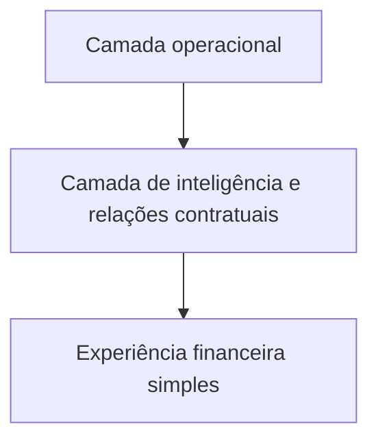

# 02 • Referências do contrato e limites da informação

| **BASE / REGISTRO** | **CONTEXTO**                                          | **CUIDADO DE INTERPRETAÇÃO**                                         |
|---------------------|-------------------------------------------------------|----------------------------------------------------------------------|
| 134 escolas         | Cadastro histórico do site                            | Não presumir identidade com todo o universo de unidades do contrato. |
| 136 designações     | Levantamento individual de 2026                       | Exige conciliação com os identificadores operacionais.               |
| 3.061 equipamentos  | Quantitativo inicial da 3ª CRE previsto no TR         | Referência contratual inicial, não cadastro individual completo.     |
| 3.253 equipamentos  | Registros individualizados em levantamento de 2026    | Não representa, por si só, ampliação contratual autorizada.          |
| 24 meses / 4 ciclos | Vigência e periodicidade de referência                | Ciclos semestrais não são cobrança automática de cota integral.      |
| R\$ 2.035.894,27    | Total indicado no cronograma financeiro de referência | Não significa despesa liquidada, valor pago ou saldo disponível.     |

O TR admite a manutenção preventiva periódica e a corretiva sob demanda,
mas a remuneração e a medição devem respeitar as condições contratuais.
Em especial, a categoria de preço não deve ser interpretada como
autorização de uma cobrança extra a cada chamado corretivo. É necessário
identificar a cobertura que o preço efetivamente remunera.

<table>
<colgroup>
<col style="width: 100%" />
</colgroup>
<thead>
<tr class="header">
<th>
<strong>ATENÇÃO CONTRATUAL</strong>

O contrato efetivamente assinado, seus eventuais aditivos e a
planilha de preços válida ainda precisam ser confrontados com as
referências usadas nos arquivos de trabalho. O desenho da experiência
pode avançar; parâmetros definitivos de cálculo não devem ser
presumidos.
</th>
</tr>
</thead>
<tbody>
</tbody>
</table>

## Não duplicar o CMMS da contratada

O item 3.15.3.3 do TR atribui à contratada um sistema próprio de
controle das manutenções. O GOP Clima não precisa reconstruir controle
de técnicos, peças, inspeções, histórico técnico integral e documentos
operacionais da empresa. A sua função é aproveitar informações
pertinentes para acompanhamento e gestão financeira sintética.

# 03 • Papel dos quatro módulos Excel

| **INSTRUMENTO**                                    | **CAPACIDADES EXISTENTES**                                                    | **TRADUÇÃO RECOMENDADA AO SITE**                                                               |
|----------------------------------------------------|-------------------------------------------------------------------------------|------------------------------------------------------------------------------------------------|
| Módulo 01 · Planejamento e demandas                | Escolas, polos, equipamentos, ciclos, programação e solicitações.             | Reaproveitar identificação, programação e previsão econômica, sem reproduzir abas de cadastro. |
| Módulo 02 · Execução, fiscalização e medição       | OES, registros técnicos, avaliação, IMR e bases de medição.                   | Consumir resultados/valores informados no acompanhamento, sem copiar formulários de atestação. |
| Módulo 03 · Faturamento, conformidade e pagamentos | Categorias, NF, empenhos, pagamentos, retenções e comparação por competência. | Principal fonte de capacidades financeiras; preservar diferenças entre os estados.             |
| Módulo 04 · Indicadores gerenciais                 | Visões consolidadas, gráficos e análises cruzadas.                            | Inspiração para uma única tela financeira clara e orientada por perguntas.                     |

A quantidade de abas e fórmulas de um módulo Excel não define a
quantidade de telas necessárias. As tabelas intermediárias existem para
cálculo, conferência e documentação; no site, esses procedimentos podem
ocorrer internamente e só aparecer quando proporcionarem utilidade
direta ao servidor.

# 04 • Visão e arquitetura de produto

Figura 2 · Três camadas de capacidade, sem criar três aplicações
independentes.

## Camada operacional

Preservar o registro dos chamados, a consulta por escola, o histórico,
as informações de setor, as comunicações e os indicadores de antiguidade
e inatividade. Essa camada é a fonte da experiência já conhecida pelo
servidor.

## Camada interna de inteligência

Relacionar identificadores de escola, equipamentos selecionados, tipos
de serviço e parâmetros contratualmente aplicáveis. Produzir cálculos,
projeções e controles de consistência sem exigir manipulação de
categorias técnicas pelo usuário. A memória e a origem dos valores devem
ser verificáveis quando houver necessidade, sem ocupar a interface
principal.

## Camada de experiência financeira

Entregar orçamentos de referência contextualizados, previsão por
competência, visão de faturamento e registros de pagamentos de modo
sintético. As informações não substituem o processo administrativo, mas
oferecem respostas gerenciais rápidas e confiáveis.

