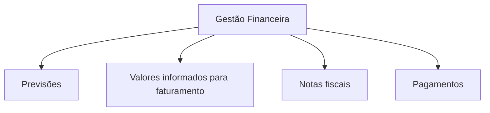

# 05 • Navegação e integração com as telas existentes

Figura 3 · Esboço editorial da nova área financeira: organização
ilustrativa, sem dados nem layout aprovados.

| **SEÇÃO DO SITE**    | **DECISÃO DE EXPERIÊNCIA**                                                                     |
|----------------------|------------------------------------------------------------------------------------------------|
| Painel               | Preservado; avaliar a inclusão discreta de síntese financeira, sem perder o foco nos chamados. |
| Chamados             | Preservada a lista operacional; mostrar referência financeira no detalhe contextual.           |
| Consulta por Unidade | Relacionar solicitações, equipamentos de referência e valores por escola.                      |
| Registrar Chamado    | Incorporar cálculo quando houver dados suficientes; sem segundo formulário financeiro.         |
| Gestão Financeira    | Única nova área principal proposta, com visão por competência e filtros claros.                |
| Comunicações e apoio | Preservar recursos existentes; não reconstruir nesta etapa.                                    |

## Interface orientada por tarefas

A tabela de chamados deve continuar respondendo “o que exige atenção?”.
O detalhe de um chamado pode responder “qual a referência financeira?”.
A consulta escolar deve responder “quais demandas e valores se
relacionam à unidade?”. O painel financeiro responde “como está o
período?”. Essa divisão evita transportar todas as contas para todas as
telas.

# 06 • Jornada de abertura e estimativa da demanda

Figura 4 · Sequência conceitual de uso: poucos atos do servidor,
múltiplos relacionamentos internos.

## A experiência desejada

Ao registrar uma ocorrência, o usuário seleciona a escola, identifica
somente os equipamentos envolvidos e informa o essencial sobre a
solicitação. O site reaproveita endereço, designação e demais dados já
presentes. Com base em tipo, BTU, serviço pertinente e cobertura
contratual, apresenta uma estimativa ou valor de referência, quando
tecnicamente possível.

## Quando o equipamento ainda não está individualizado

O repositório contém quantidades de aparelhos por escola e campos
técnicos nos chamados, mas não demonstra uma coleção individual completa
equivalente ao levantamento Excel. Por isso, a concepção prevê duas
rotas: seleção direta quando houver um equipamento identificável;
informação técnica mínima quando faltar cadastro individual. A segunda
rota não deve criar automaticamente registro patrimonial nem inventar
potência ou categoria.

## Para manutenção corretiva

A informação de custo deve informar o enquadramento e a cobertura
contratual. Um chamado de reparo pode estar abrangido pela remuneração
global da categoria e, portanto, não corresponder a nova parcela a
pagar. O produto não pode fazer surgir uma cobrança simplesmente porque
o usuário marcou o chamado como resolvido.

## Para programação preventiva

A base semestral e o roteiro disponível alimentam uma previsão por mês e
escola. Reprogramações atualizam a projeção sem duplicar o equipamento
em dois períodos ativos. A programação é informação de planejamento, e
não comprovação da execução.

# 07 • Gestão Financeira: uma única área de consulta

## Quatro grupos de informação essenciais

| **BLOCO**                          | **PERGUNTA ATENDIDA**                                                  | **RECOMENDAÇÃO VISUAL**                      |
|------------------------------------|------------------------------------------------------------------------|----------------------------------------------|
| Previsão                           | O que está programado ou estimado para o período?                      | Indicador conciso e tendência mensal.        |
| Consolidação da execução informada | Que valor foi encaminhado à composição financeira?                     | Resumo e consulta dos registros de origem.   |
| Faturamento e pagamentos           | Quais NFs estão registradas, e quais pagamentos foram informados?      | Situações claras e consulta por competência. |
| Limites e empenhos                 | Qual a referência contratual e qual o estado dos empenhos disponíveis? | Nomes precisos para grandezas distintas.     |

## Filtros principais e comportamento esperado

Competência, escola e situação financeira devem ocupar a primeira camada
de filtros. Polo e modalidade são recortes secundários possíveis. Um
filtro de escola não pode alterar indevidamente um teto global; a
seleção ativa precisa ser indicada e pode ser desfeita com facilidade.

## Gráficos somente quando responderem a perguntas

Recomenda-se comparação mensal entre previsto, faturado e pago, com
séries nomeadas; ranking horizontal para concentração por escola, quando
pertinente; e lista simples para identificar os registros que compõem um
total. Não utilizar gráficos decorativos, pizza indiscriminada ou
velocímetros cujo significado seja incerto.

## Registro resumido de NF e pagamento

A partir do contexto da competência, a interface recupera o que já é
conhecido e solicita somente informações necessárias sobre NF, valor,
situação e referência de pagamento. O usuário não deverá repetir
contrato, escola e competência quando estiverem determinados. Identidade
da NF, liquidação informada e pagamento informado são estados
diferentes, sem simular atos em sistema oficial.

