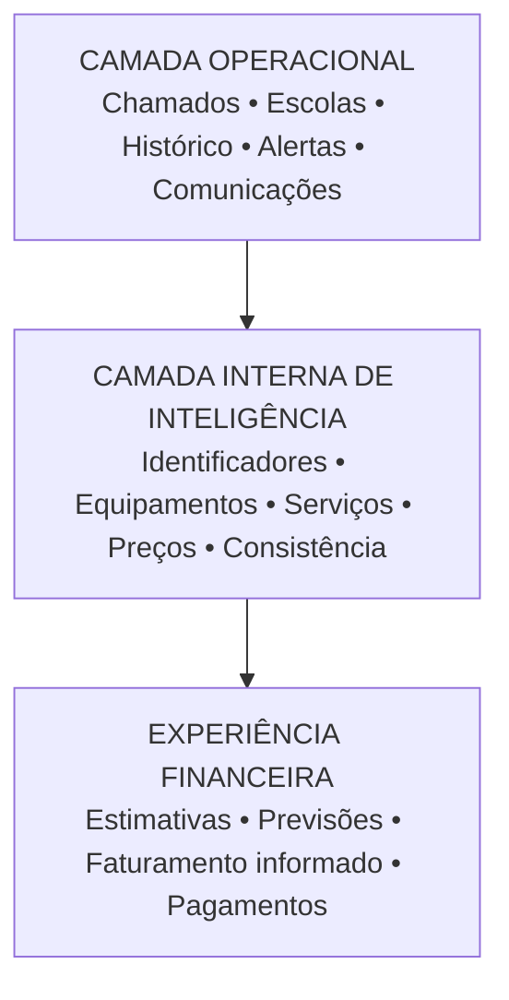
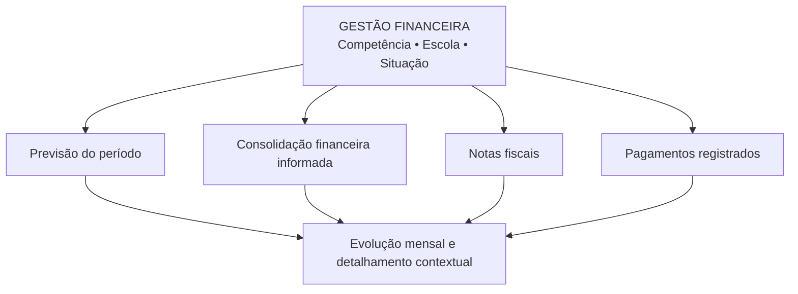

# 04 • Visão e arquitetura de produto

## Figura 2 — três camadas, um produto

*Três camadas de capacidade, sem criar três aplicações independentes.*

## Camada operacional

Preservar o registro dos chamados, a consulta por escola, o histórico, as informações de setor, as comunicações e os indicadores de antiguidade e inatividade. Essa camada é a fonte da experiência já conhecida pelo servidor.

## Camada interna de inteligência

Relacionar identificadores de escola, equipamentos selecionados, tipos de serviço e parâmetros contratualmente aplicáveis. Produzir cálculos, projeções e controles de consistência sem exigir manipulação de categorias técnicas pelo usuário. A memória e a origem dos valores devem ser verificáveis quando houver necessidade, sem ocupar a interface principal.

## Camada de experiência financeira

Entregar orçamentos de referência contextualizados, previsão por competência, visão de faturamento e registros de pagamentos de modo sintético. As informações não substituem o processo administrativo, mas oferecem respostas gerenciais rápidas e confiáveis.

# 05 • Navegação e integração com as telas existentes

## Figura 3 — esboço conceitual da área financeira

*Esta figura representa a organização funcional da tela descrita no Word. Não representa dados reais, nem aprova componentes visuais ou layout definitivo.*

| Seção do site | Decisão de experiência |
|---|---|
| Painel | Preservado; avaliar a inclusão discreta de síntese financeira, sem perder o foco nos chamados. |
| Chamados | Preservada a lista operacional; mostrar referência financeira no detalhe contextual. |
| Consulta por Unidade | Relacionar solicitações, equipamentos de referência e valores por escola. |
| Registrar Chamado | Incorporar cálculo quando houver dados suficientes; sem segundo formulário financeiro. |
| Gestão Financeira | Única nova área principal proposta, com visão por competência e filtros claros. |
| Comunicações e apoio | Preservar recursos existentes; não reconstruir nesta etapa. |

## Interface orientada por tarefas

A tabela de chamados deve continuar respondendo “o que exige atenção?”. O detalhe de um chamado pode responder “qual a referência financeira?”. A consulta escolar deve responder “quais demandas e valores se relacionam à unidade?”. O painel financeiro responde “como está o período?”. Essa divisão evita transportar todas as contas para todas as telas.
