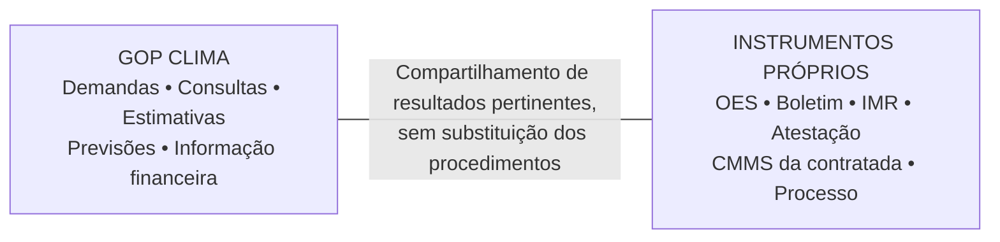

# 08 • Distinções financeiras obrigatórias

| Informação | Significado no site |
|---|---|
| Preço ou referência contratual | Parâmetro associado a uma categoria e cobertura válida. |
| Estimativa de demanda | Previsão calculada conforme dados e serviço pertinentes; não é valor necessariamente devido. |
| Programação por competência | Distribuição planejada, separada de serviços efetivamente executados. |
| Valor informado para faturamento | Resultado de procedimento externo referenciado, não gerado por status genérico. |
| Nota fiscal registrada | Documento identificado, com competência e valor conforme informação inserida. |
| Liquidação informada | Registro da condição comunicada; não executa liquidação no sistema contábil. |
| Pagamento informado | Registro do desembolso identificado, que pode ocorrer em mês posterior ao da execução. |

## Figura 5 — três calendários

*Competência, programação de desembolso e pagamento são referências temporais diferentes.*

A expressão “saldo disponível” deve ser desambiguada. Teto contratual, saldo de empenho e disponibilidade financeira não são sinônimos. O painel deverá usar denominações precisas e identificar o dado ausente como “não informado”, nunca como zero presumido.

## IMR, glosas e descontos

A avaliação técnica detalhada e sua documentação podem permanecer nas planilhas e instrumentos da fiscalização. O site deverá utilizar o resultado devidamente informado, sem presumir IMR integral, glosa automática de chamado não executado ou retenção fixa por porcentagem genérica. A eventual repercussão financeira será representada conforme os dados e regras aplicáveis.

# 09 • Fronteiras, responsabilidades e governança

## Figura 6 — responsabilidades separadas

*Divisão intencional entre o site gerencial e os instrumentos técnicos/administrativos.*

## Perfis funcionais, sem multiplicar portais

| Perfil de uso | Tarefa mais frequente | Experiência recomendada |
|---|---|---|
| Registro operacional | Abrir e atualizar demandas | Mesmo fluxo atual, com referência financeira contextual. |
| Coordenação | Acompanhar demandas e programação | Painel sintético e busca por escola/competência. |
| Acompanhamento financeiro | Consultar faturas, empenhos e pagamentos | Área de Gestão Financeira e registros curtos. |
| Fiscalização/gestão contratual | Consultar resultado relevante para procedimentos externos | Leitura e referência, sem recriar atestação ou processo. |

Os perfis representam necessidades, não autorização para criar categorias de login. Porém, a inserção de valores de notas fiscais, empenhos e pagamentos deve ser restrita a responsáveis autorizados; o regime histórico de acesso aberto à edição operacional não pode ser simplesmente estendido à nova área financeira.
